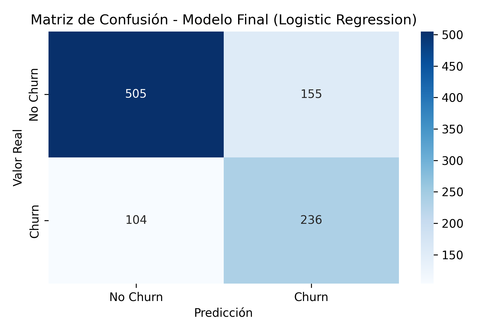
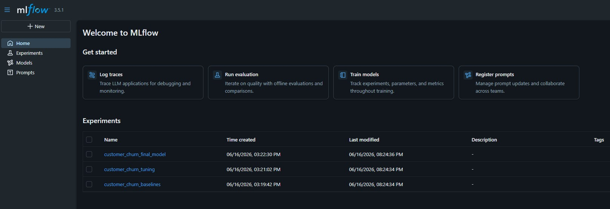
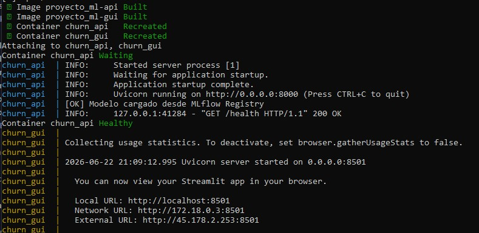
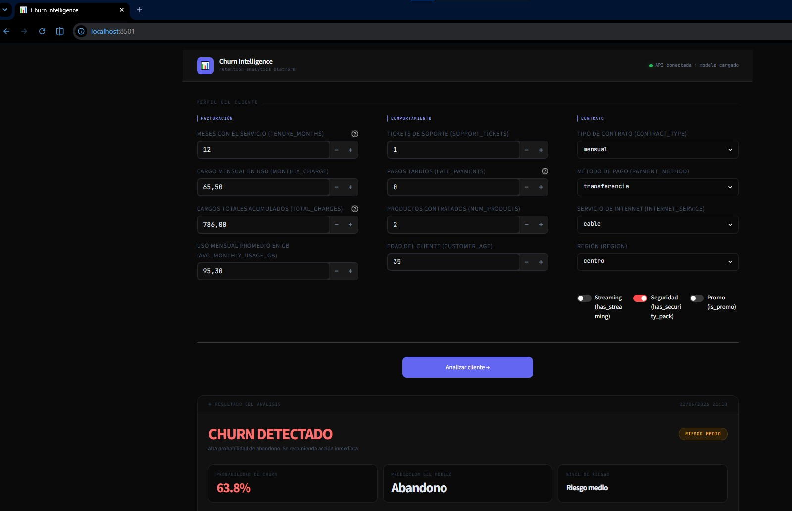
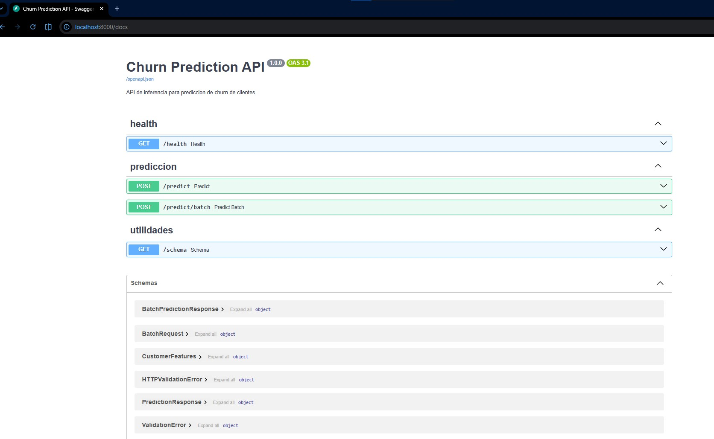
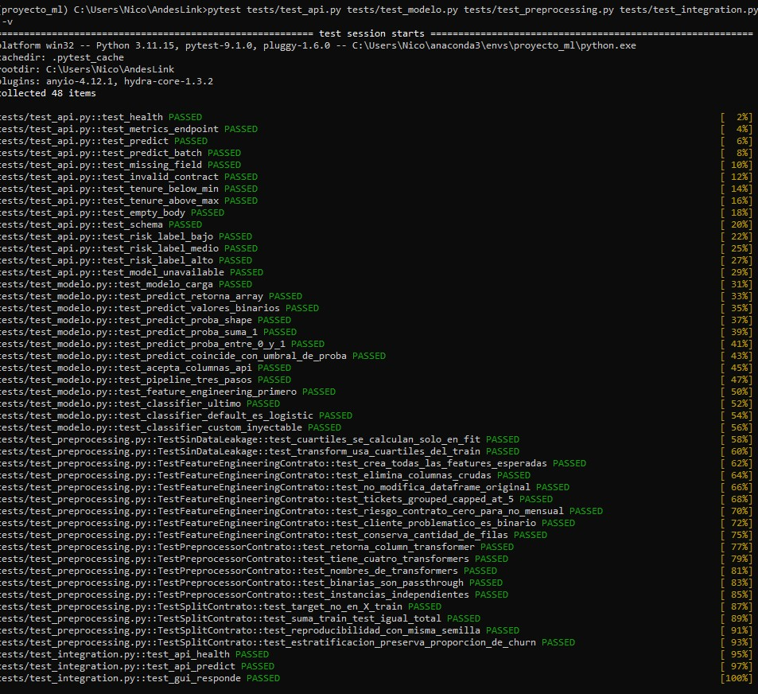
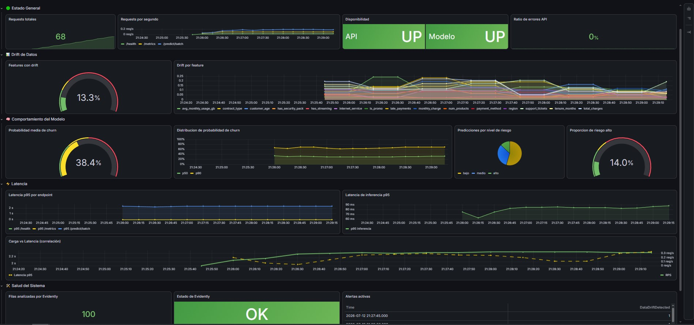
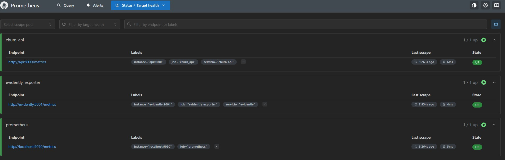

# Predicción de Churn de Clientes — MLOps de punta a punta

[Read in English](README.en.md)

Proyecto de Machine Learning y MLOps de punta a punta para predecir la baja de clientes (*churn*) y construir un sistema completo de entrenamiento, despliegue, pruebas y monitoreo.

El proyecto implementa el ciclo de vida completo de ML:

**Datos → Preprocesamiento → Feature Engineering → Entrenamiento → Seguimiento de experimentos → API → Despliegue → Monitoreo**

---

## 📌 Descripción general

El objetivo es predecir si un cliente tiene probabilidad de abandonar el servicio y ofrecer un sistema orientado a producción, capaz de servir predicciones y de monitorear tanto la API como el comportamiento del modelo.

El proyecto incluye:

* Análisis exploratorio de datos (EDA)
* Preprocesamiento y feature engineering
* Comparación de Regresión Logística, Random Forest y XGBoost
* Ajuste de hiperparámetros
* Seguimiento de experimentos con MLflow
* Versionado de datos y modelos con DVC
* Serialización del modelo
* API REST con FastAPI
* Interfaz interactiva con Streamlit
* Despliegue con Docker y Docker Compose
* Pruebas automatizadas con Pytest
* Monitoreo de la API con Prometheus
* Detección de data drift con Evidently
* Dashboards de monitoreo con Grafana
* Alertas automáticas ante problemas del sistema y del modelo

---

## 📊 Rendimiento del modelo

El modelo final es una **Regresión Logística con regularización L1 y ponderación de clases**.

| Métrica           |     Valor |
| ----------------- | --------: |
| Accuracy          | **0.741** |
| Precisión (Churn) | **0.604** |
| Recall (Churn)    | **0.694** |
| F1 Score          | **0.646** |
| ROC-AUC           | **0.798** |

El modelo final se seleccionó tras evaluar y comparar varios enfoques de Machine Learning.

### Matriz de confusión



---

## 🏗️ Arquitectura del proyecto

```text
                    ┌─────────────────┐
                    │   Raw Dataset   │
                    └────────┬────────┘
                             │
                             ▼
                  ┌─────────────────────┐
                  │ Preprocessing &     │
                  │ Feature Engineering │
                  └──────────┬──────────┘
                             │
                             ▼
                  ┌─────────────────────┐
                  │ Model Training &    │
                  │ Experiment Tracking │
                  └──────────┬──────────┘
                             │
                             ▼
                    ┌─────────────────┐
                    │  Trained Model  │
                    └────────┬────────┘
                             │
                             ▼
                    ┌─────────────────┐
                    │   FastAPI API   │
                    └────────┬────────┘
                             │
                       ┌─────┴─────┐
                       ▼           ▼
                ┌────────────┐ ┌────────────┐
                │ Streamlit  │ │ Monitoring │
                │    GUI     │ │    Stack   │
                └────────────┘ └──────┬─────┘
                                      │
                               ┌──────┴──────┐
                               ▼             ▼
                          Prometheus      Grafana
                               │
                               ▼
                           Evidently
                        Data Drift Detection
```

---

## 🗂️ Estructura del repositorio

```text
customer-churn-prediction/
├── .github/
├── data/
│   ├── raw/                        # Dataset crudo
│   └── processed/                  # Datasets procesados
├── docker/
│   ├── Dockerfile.api
│   ├── Dockerfile.streamlit
│   ├── Dockerfile.evidently
│   └── Dockerfile.traffic
├── models/                         # Modelo entrenado y métricas
├── monitoring/
│   ├── prometheus.yml
│   ├── rules.yml
│   └── provisioning/
├── notebooks/
│   └── notebook.ipynb              # EDA y experimentación
├── reports/                        # Informes técnicos y evidencias
├── requirements/
│   ├── api.txt
│   ├── streamlit.txt
│   ├── monitoring.txt
│   └── traffic.txt
├── src/
│   ├── preprocessing.py
│   ├── feature_engineering.py
│   ├── train.py
│   ├── main.py
│   ├── api/
│   │   ├── api.py
│   │   ├── schemas.py
│   │   ├── metrics.py
│   │   └── inference_logger.py
│   ├── gui/
│   │   └── app.py
│   └── monitoring/
│       ├── evidently_monitor.py
│       ├── evidently_exporter.py
│       └── traffic_generator.py
├── tests/
├── tracking/
│   └── experiments.py
├── .dvcignore
├── .gitignore
├── docker-compose.yml
├── environment.yml
└── README.md
```

---

# 🛠️ Tecnologías

### Machine Learning

* Python
* Pandas
* NumPy
* Scikit-learn
* XGBoost

### MLOps

* DVC
* MLflow
* Docker
* Docker Compose

### Despliegue

* FastAPI
* Streamlit

### Monitoreo

* Prometheus
* Grafana
* Evidently

### Pruebas y desarrollo

* Pytest
* Jupyter
* Conda

---

# 🚀 Primeros pasos

## Requisitos

Se necesitan las siguientes herramientas:

* **Anaconda o Miniconda**
* **Docker**
* **Docker Compose**
* **Git**

Docker es necesario para el despliegue y el monitoreo. Conda se usa para el entrenamiento, los notebooks, DVC y las pruebas locales.

---

## Instalación

### 1. Clonar el repositorio

```bash
git clone https://github.com/nicocarrero/customer-churn-prediction.git
cd customer-churn-prediction
```

### 2. Crear el entorno de Conda

```bash
conda env create -f environment.yml
conda activate proyecto_ml
```

### 3. Configurar DVC

Configurar localmente las credenciales del remoto de DVC:

```bash
dvc remote modify origin --local auth basic
dvc remote modify origin --local user TU_USUARIO_DAGSHUB
dvc remote modify origin --local password TU_TOKEN_DAGSHUB
```

> Las credenciales se configuran de forma local y nunca deben subirse al repositorio.

### 4. Descargar datos y artefactos del modelo

```bash
dvc pull
```

Esto descarga los datasets y artefactos del modelo necesarios, entre ellos:

* `data/raw/churn_sintetico.csv`
* `data/processed/data_final.csv`
* `models/model_pipeline.joblib`

---

# 🧠 Entrenamiento

El entrenamiento requiere el entorno de Conda:

```bash
conda activate proyecto_ml
```

## Ejecutar el pipeline de entrenamiento

```bash
python src/main.py
```

El pipeline realiza:

1. Preprocesamiento de datos
2. Feature engineering
3. Entrenamiento del modelo
4. Evaluación del modelo
5. Serialización del modelo
6. Generación de métricas
7. Generación de la matriz de confusión

El modelo entrenado se guarda en:

```text
models/model_pipeline.joblib
```

Las métricas se guardan en:

```text
models/metrics.json
```

---

## 🔬 Análisis exploratorio de datos

El proyecto incluye un notebook de Jupyter con:

* Análisis exploratorio de datos
* Preprocesamiento
* Análisis de variables
* Comparación de modelos
* Feature engineering
* Evaluación del modelo

Para ejecutarlo:

```bash
jupyter lab notebooks/notebook.ipynb
```

---

## 📈 Seguimiento de experimentos con MLflow

Los experimentos se registran con **MLflow** y se almacenan en DagsHub.

El proyecto evalúa:

* Regresión Logística
* Random Forest
* XGBoost

Los experimentos se pueden consultar desde el navegador:

https://dagshub.com/carreronicoo/proyecto_ml.mlflow/

### Evidencias

**Comparación de experimentos en MLflow**



**Matriz de confusión del modelo final**


Las matrices de confusión generadas para los modelos evaluados están en:

```text
reports/cm_exp_*.png
```

---

# 🌐 Despliegue

La aplicación se despliega con **Docker Compose**.

La API carga el modelo entrenado desde:

```text
models/model_pipeline.joblib
```

El modelo se incluye en la imagen Docker de la API durante el build.

## Levantar API + GUI

```bash
docker compose up --build api gui
```

### Servicios

| Servicio   | URL                        |
| ---------- | -------------------------- |
| FastAPI    | http://localhost:8000      |
| Swagger UI | http://localhost:8000/docs |
| Streamlit  | http://localhost:8501      |

Para detener los servicios:

```bash
docker compose down
```

La interfaz de Streamlit se comunica con el servicio FastAPI a través de la red interna de Docker.

---

# 🔌 API

La API REST está construida con **FastAPI**.

## `POST /predict`

Recibe los datos de un cliente y devuelve la predicción de churn, la probabilidad y el nivel de riesgo.

### Ejemplo de solicitud

```json
{
  "tenure_months": 12,
  "monthly_charge": 65.50,
  "total_charges": 786.0,
  "support_tickets": 1,
  "late_payments": 0,
  "avg_monthly_usage_gb": 95.3,
  "contract_type": "anual",
  "payment_method": "debito",
  "internet_service": "fibra",
  "has_streaming": 1,
  "has_security_pack": 0,
  "num_products": 2,
  "region": "centro",
  "customer_age": 35,
  "is_promo": 0
}
```

### Ejemplo de respuesta

```json
{
  "churn_prediction": 1,
  "churn_probability": 0.82,
  "risk_level": "alto"
}
```

Niveles de riesgo:

* **Bajo:** `< 0.35`
* **Medio:** `0.35 – 0.65`
* **Alto:** `> 0.65`

---

## Endpoints de la API

| Método | Endpoint         | Descripción                                  |
| ------ | ---------------- | -------------------------------------------- |
| GET    | `/health`        | Estado del servicio y disponibilidad del modelo |
| POST   | `/predict`       | Predicción individual                        |
| POST   | `/predict/batch` | Predicciones por lote                        |
| GET    | `/schema`        | Esquema de entrada del cliente               |
| GET    | `/metrics`       | Métricas de Prometheus                       |

Si el modelo no está disponible, `/predict` y `/predict/batch` devuelven HTTP `503`.

---

# 🧪 Pruebas

Las pruebas unitarias requieren el entorno de Conda:

```bash
conda activate proyecto_ml
```

Ejecutar las pruebas:

```bash
pytest tests/test_api.py tests/test_modelo.py tests/test_preprocessing.py -v
```

### Prueba de integración

La prueba de integración requiere que Docker Compose esté corriendo:

```bash
docker compose up -d api gui
```

Luego:

```bash
pytest tests/test_integration.py -v
```

### Evidencias

**Docker Compose — API + GUI**



**Interfaz de Streamlit**



**FastAPI Swagger UI**



**Pytest**



---

# 📡 Monitoreo

El proyecto implementa un stack de monitoreo completo con:

* Prometheus
* Grafana
* Evidently

El sistema de monitoreo supervisa tanto el **rendimiento de la aplicación** como el **comportamiento del modelo de Machine Learning**.

---

## Levantar el sistema completo

```bash
docker compose up --build
```

Esto inicia:

* API
* Streamlit
* Generador de tráfico
* Evidently Exporter
* Prometheus
* Grafana

### Servicios

| Servicio           | URL                           |
| ------------------ | ----------------------------- |
| FastAPI            | http://localhost:8000         |
| Streamlit          | http://localhost:8501         |
| Evidently Exporter | http://localhost:8001/metrics |
| Prometheus         | http://localhost:9090         |
| Grafana            | http://localhost:3000         |

---

## 🚦 Generador de tráfico

El generador de tráfico simula solicitudes de clientes contra `/predict`.

Toma muestras del dataset original y puede inyectar data drift sintético controlado mediante la variable:

```text
DATA_DRIFT_PROB
```

Los datos generados se guardan en:

```text
data/processed/current_data.csv
```

Evidently usa este dataset como el conjunto "actual", similar a producción, para el análisis de drift.

---

## 📊 Métricas de la API

La API expone métricas de Prometheus como:

* `api_requests_total`
* `api_request_latency_seconds`
* `api_request_errors_total`
* `model_availability`
* `model_inference_duration_seconds`
* `churn_predictions_total`
* `churn_probability_score`
* `mlops_churn_probability_mean`

---

## 🔎 Métricas de Evidently

El exporter de Evidently expone métricas como:

* `mlops_drifted_features_ratio`
* `mlops_feature_drift_score{feature=...}`
* `mlops_current_rows`
* `mlops_high_risk_ratio`
* `mlops_evidently_report_success`
* `mlops_evidently_last_run_timestamp`

---

## 🚨 Alertas

Las reglas de alerta de Prometheus están definidas en:

```text
monitoring/rules.yml
```

El proyecto incluye alertas para:

| Alerta                      | Condición                                     |
| --------------------------- | --------------------------------------------- |
| `APIDown`                   | API no disponible durante 1 minuto            |
| `ModelUnavailable`          | Modelo no cargado                             |
| `EvidentlyExporterDown`     | Exporter no disponible                        |
| `HighRequestLatencyP95`     | Latencia HTTP p95 > 1 s                       |
| `HighModelInferenceLatency` | Inferencia del modelo p95 > 0.5 s             |
| `HighErrorRate`             | Tasa de errores > 5%                          |
| `DataDriftDetected`         | Drift en más del 30% de las variables         |
| `EvidentlyReportFailed`     | Falla en el análisis de Evidently             |

---

# 📊 Dashboard de Grafana

Grafana se aprovisiona automáticamente con la fuente de datos de Prometheus y el dashboard de MLOps.

No requiere configuración manual.

### Evidencias

**Dashboard de Grafana**



**Prometheus**



---

## 📈 Reporte de Evidently

El proceso de monitoreo compara:

```text
Dataset de referencia:
data/raw/churn_sintetico.csv

Dataset actual:
data/processed/current_data.csv
```

Evidently analiza las diferencias entre ambos datasets y publica los resultados como métricas de Prometheus.

El exporter ejecuta el análisis periódicamente según la variable:

```text
RUN_INTERVAL
```

El intervalo por defecto es de **30 segundos**.

---

# 📚 Documentación adicional

Para más detalle sobre la implementación:

* **Informe técnico:** `reports/INFORME_TECNICO.md`
* **Notebook exploratorio:** `notebooks/notebook.ipynb`

---
